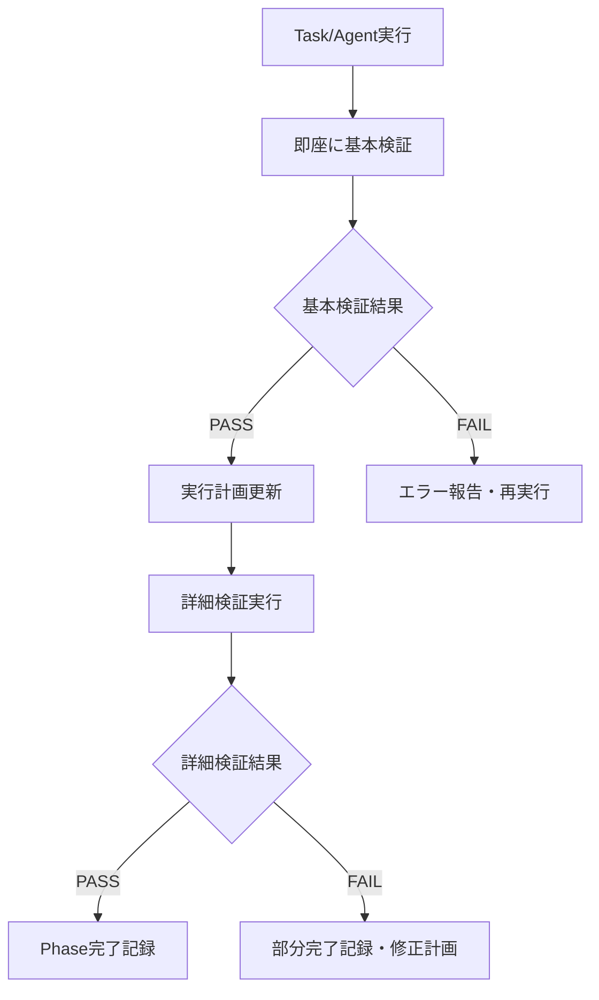

# 実行計画管理システム改善提案

## 問題の概要

### 現在の問題

- Task/Agent実行時の報告内容と実ファイルシステムの乖離
- 実行結果の信頼性が低く、検証工程が必須
- 実装完了と報告されても実際には未実装

### 影響

- 開発効率の大幅低下
- 品質保証プロセスの複雑化
- プロジェクト進捗の見積もり困難

## 改善提案

### 1. 実行後検証システム (Post-Execution Verification System)

#### 自動検証フレームワーク

```markdown
# 実行計画テンプレート v2.0

## Phase X: [フェーズ名]

### 実行計画
- [ ] Step 1: [作業内容]
- [ ] Step 2: [作業内容]

### 検証項目 (自動実行)
- [ ] **ファイル存在確認**: `find [path] -name "[pattern]"`
- [ ] **内容確認**: `grep -c "[expected_content]" [file]`
- [ ] **権限確認**: `ls -la [file]`
- [ ] **Git状態確認**: `git status | grep [file]`

### 検証結果
- 実行日時: [自動記録]
- 検証ステータス: [PASS/FAIL]
- 検証詳細: [自動記録]
```

#### 検証スクリプトテンプレート

```bash
#!/bin/bash
# verification-template.sh

PHASE_NAME="$1"
PLAN_FILE="$2"

echo "=== 実行後検証開始: $PHASE_NAME ==="

# 1. ファイル存在確認
echo "1. ファイル存在確認..."
EXPECTED_FILES=(
    "/path/to/expected/file1.ts"
    "/path/to/expected/file2.js"
)

for file in "${EXPECTED_FILES[@]}"; do
    if [[ -f "$file" ]]; then
        echo "✅ $file - 存在"
    else
        echo "❌ $file - 不存在"
        VERIFICATION_FAILED=true
    fi
done

# 2. 内容確認
echo "2. ファイル内容確認..."
CONTENT_CHECKS=(
    "file1.ts:export class GlobalExceptionFilter"
    "file2.ts:describe('Test Suite'"
)

for check in "${CONTENT_CHECKS[@]}"; do
    file=$(echo $check | cut -d':' -f1)
    pattern=$(echo $check | cut -d':' -f2)

    if grep -q "$pattern" "$file" 2>/dev/null; then
        echo "✅ $file - '$pattern' 確認"
    else
        echo "❌ $file - '$pattern' 未確認"
        VERIFICATION_FAILED=true
    fi
done

# 3. Git状態確認
echo "3. Git状態確認..."
git status --porcelain | while read line; do
    echo "📝 Git変更: $line"
done

# 結果記録
if [[ "$VERIFICATION_FAILED" == "true" ]]; then
    echo "❌ 検証失敗: 期待される変更が確認できませんでした"
    exit 1
else
    echo "✅ 検証成功: 全ての期待される変更が確認できました"
    exit 0
fi
```

### 2. 段階的実行システム (Staged Execution System)

#### 実行フロー改善



#### 実行計画書の強化

```markdown
### Phase実行記録テンプレート

#### 実行前状態
- Git Hash: [記録]
- ファイル数: [記録]
- 最終更新: [記録]

#### 実行指示
- エージェント: [backend/test/frontend等]
- 実行時刻: [記録]
- 指示内容: [詳細記録]

#### 即座検証 (実行直後)
- [ ] ファイルシステム変更確認
- [ ] Git状態変更確認
- [ ] 期待ファイル存在確認
- 検証時刻: [記録]
- 検証結果: [PASS/FAIL/PARTIAL]

#### 詳細検証 (5分後)
- [ ] ファイル内容確認
- [ ] 依存関係確認
- [ ] 統合性確認
- 検証時刻: [記録]
- 検証結果: [PASS/FAIL/PARTIAL]

#### 実行後状態
- Git Hash: [記録]
- ファイル数: [記録]
- 差分サマリー: [記録]
```

### 3. 信頼性確保メカニズム

#### Task実行の信頼性向上

1. **実行確認待機時間**: Task実行後、30秒の待機期間を設ける
2. **段階的検証**: 即座検証 → 詳細検証 → 統合検証の3段階
3. **フォールバック手順**: Agent実行失敗時の直接実装手順を明記

#### 実行計画書の自動更新

```bash
# 自動更新スクリプト例
update_plan() {
    local phase="$1"
    local status="$2"
    local timestamp="$3"

    # 実行計画書を自動更新
    sed -i "s/### $phase: \[.*\]/### $phase: $status ($timestamp)/" plan.md

    # 検証結果を追記
    echo "検証実行時刻: $timestamp" >> plan.md
    echo "検証結果: $(run_verification)" >> plan.md
}
```

### 4. 品質保証の自動化

#### 継続的検証システム

```bash
# 継続的検証スクリプト
continuous_verification() {
    while true; do
        # 5分ごとに実行計画の整合性を確認
        verify_plan_integrity

        # 不整合発見時はアラート
        if [[ $? -ne 0 ]]; then
            alert_inconsistency
        fi

        sleep 300  # 5分待機
    done
}
```

## 実装優先度

### Phase 1: 基本検証システム (即座実装可能)

- [x] 実行後検証スクリプト作成
- [ ] 実行計画書テンプレート更新
- [ ] 基本検証の自動実行

### Phase 2: 自動化システム (1週間)

- [ ] 段階的検証システム
- [ ] 実行計画書自動更新
- [ ] エラーハンドリング強化

### Phase 3: 統合システム (2週間)

- [ ] 継続的検証システム
- [ ] ダッシュボード機能
- [ ] 履歴管理システム

## 期待効果

### 短期効果 (1週間以内)

- Task/Agent実行結果の信頼性向上
- 実装確認時間の大幅短縮
- 開発効率の改善

### 中長期効果 (1ヶ月以内)

- 品質保証プロセスの自動化
- プロジェクト進捗の正確な把握
- 開発チームの生産性向上

## 実装開始提案

この改善システムを Exception Filter プロジェクトに適用し、有効性を検証することを提案します。

---

**作成日**: 2025-09-08
**ステータス**: 提案段階
**優先度**: 高
